# Car Rental: a small rental agency, run from a phone

Small car rental agencies in Tunisia still run on a paper notebook: who has which car, until when, who paid, what the car cost, what is in the till. This repository is the software built to replace that notebook. It has a Laravel API, a React Native app for the agency's staff, a Next.js web version of the same app, and the Docker Compose, Caddy and OpenTofu files that deploy them.

It covers the whole day of an agency: which car is free and at what price, booking, handing the car over and taking it back with photos and damage, the deposit, payments, traffic fines, the cars' papers and maintenance, what each car cost and earned, the cash book, payroll and the monthly report. Money is stored in integer millimes, never floats.

I built it with Claude Code from September 2026. I wrote a first version by hand in 2024 and 2025 ([app](https://github.com/mkhinini-motaz/car), [API](https://github.com/mkhinini-motaz/carapi)). It is not in use at an agency yet.


[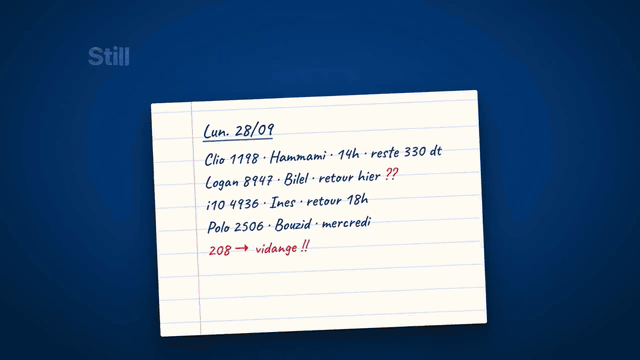](docs/media/brag.mp4)

A 26 second demo: the planning board, the client check-in page, importing the old notebook, and the themes.

## At a glance

- One API behind a phone app and a web app for the staff, and a check-in page for clients.
- 100 API routes, every one scoped to the user's agency.
- 241 automated tests: 99 in the API, 135 in the web app and 7 in the phone app. GitHub Actions runs them on every push.
- Five UI languages with 1,278 strings each: English, French, Arabic, and Tunisian Arabic (Derja) in Latin and in Arabic script. Right-to-left layout for the Arabic ones.
- Contracts, invoices and receipts as PDF, in French and in Arabic.
- Handover works offline on the phone and is sent when the network comes back.

## What it does

**At the counter**
- *Today*: cars at the agency, cars out, due back today and overdue.
- What goes out and comes back today, in time order, with the client's phone, the delivery place and the rent still owed. Pick up or Return is one tap away.
- Planning board: one row per car and one column per day, for a week or a month. Rentals show as bars coloured by status, overdue ones in red, blocked days in grey. Tap an empty day to book that car or block it for the garage.
- Availability for any period: the free cars with their free stretches, the freest first. A car not back from its last rental comes last, with a warning.
- Book one or several cars in one go. Each gets the price from the agency's rules (season, long-rental discount, with the reason shown), and staff can change it.
- A second driver, extras per rental or per day, and delivery to a frequent place (airport, hotel) or an address.
- Where the booking came from: walk-in, phone, WhatsApp, social media, website, or a broker who takes a commission.
- Two people booking the same car at the same moment cannot both succeed: the overlap check runs in a transaction that locks the car's row.

**Handing over and taking back**
- Odometer, the deposit and how it was paid, photos from six fixed angles plus close-ups, damage marked by tapping a car outline, and the client's signature.
- No pickup until the client's ID number, licence number and licence date are known, nor the second driver's licence. The agency can set a minimum age and a minimum number of years with a licence.
- A check-in link for the client: before arriving, they enter and photograph their ID and licence and can sign the contract, so the counter only checks.
- At return, each pickup photo sits next to the new one, earlier damage is greyed on the outline, and new damage can be priced.
- Lateness, and kilometres over the allowance when the agency charges for them, are computed as the odometer is typed. Staff can waive a charge or take it from the deposit.
- Damage stays on the car across rentals until it is repaired.
- A returned car is marked to clean until someone ticks it; a car brought back dirty can be charged its wash.
- Pickups and returns can be given to a member of staff, who gets a push notification.
- Without network (car parks, airports), the phone keeps the handover with its photos and real time, and sends it when the network is back.

**Contracts and payments**
- A rental goes reserved, out, returned, closed, or cancelled (see the diagram below).
- Payments in cash, card, transfer or cheque, or taken from the deposit. Closing needs everything paid. Keeping part of the deposit is for the owner only and needs a reason.
- PDFs of the contract, the invoice (with VAT and fiscal stamp) and each receipt, in French or Arabic.
- Every change to a contract is logged with who made it.

**Clients**
- A name and a phone are enough to book. ID card and licence photos can be added, and deleted on request.
- A track record per client: rentals, revenue, average rental, balance, unpaid fines, damage, late returns, cancellations, no-shows. A badge sums it up: new, good, watch or risk.
- Flags for unpaid, damage, late returns or other. When a flagged person books again under another phone number, the app warns, because it matches the ID card and licence numbers too.

**The fleet**
- Each car with its registration card and papers. Insurance, circulation tax and technical inspection dates turn orange, then red, as they near their end.
- Oil changes due by kilometres or by months.
- Purchase price, fees, and a credit or leasing with its instalments; each instalment paid becomes an expense on the car. Selling a car keeps its history, and is refused while it has a rental booked or out.
- For each car: what it cost, how much of that its rentals have earned back, cost per kilometre, and days rented, idle and at the garage.
- The date each car must leave the fleet: first registration plus the agency's number of years.

**Traffic fines**
- A fine is matched to the rental that had the car at that moment.
- Its two sides are tracked apart. The agency pays the authority. The client pays the agency or the authority, or it comes from the deposit, or the agency bears it.
- Cash both ways goes into the cash book.

**The agency's money**
- The cash book for any day: opening and closing balance, every cash line with who handled it, a filter per staff member, plus money put in, owner withdrawals and bank deposits.
- Expenses per car or for the agency, other income, recurring bills with their due dates, branches and their rent.
- Payroll: salaries, advances and bonuses, in cash or by bank, with what is still due.
- The monthly report: revenue (rent spread over the days rented), costs, net and utilisation, with the change since last month, and the 12 months before.
- Also in the report: each car's payback, clients by revenue, who owes rent, deposits held and bookings for the next 30 days.
- Fleet renewal: when each car must be sold, and the capital that comes back within a year. The month exports to a spreadsheet.

**Agencies and staff**
- Many agencies share one database. Another agency's record answers exactly like one that does not exist.
- A test walks every route behind sign-in to prove it, so a new route is covered without touching the test.
- Owners and managers. A manager tied to a branch sees that branch's cars and the cars in no branch.
- An agency signs itself up with a code sent by SMS. The owner invites staff the same way, and a forgotten password is reset with a code.
- Changing a password ends the old sessions, and login allows five attempts a minute.
- Photos and papers are stored privately and served through signed links.

**Joining with a past**
- Import cars, clients and rentals from spreadsheets. Cells are read the way people type them: `22 123 456`, `90,5 DT`, `5/3/24`, headers in French.
- Each fix is reported as certain or a guess. A dry run comes first, and importing again never doubles a row.
- A rental from the paper notebook is entered in one step, without the client's papers.
- Scratches already on a car, credit instalments already paid and oil changes never recorded are entered, and reports start on the day the agency joined.

**Alerts and look**
- A push notification every morning at 08:00 Tunis time, in each phone's language: today's pickups and returns, overdue cars, and papers ending in 30, 7 or 1 days.
- Text messages through WinSMS, Orange or any HTTP gateway. A gateway that fails is logged and never breaks the request.
- 18 colour themes, in light or dark mode, or following the device.

## Architecture

<picture><source media="(prefers-color-scheme: dark)" srcset="docs/diagrams/architecture-dark.svg"></picture>

The phone app's release builds talk to the API's domain. There is no Redis and no queue worker: the API queues nothing, and its cache uses the database.

### A rental's life

<picture><source media="(prefers-color-scheme: dark)" srcset="docs/diagrams/rental-states-dark.svg"></picture>

A rental from the paper notebook is entered already returned, or closed if it was paid in full.

### Handover without network

<picture><source media="(prefers-color-scheme: dark)" srcset="docs/diagrams/offline-handover-dark.svg">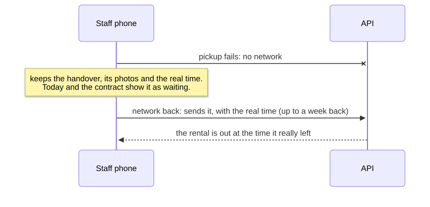</picture>

### Data model

<picture><source media="(prefers-color-scheme: dark)" srcset="docs/diagrams/data-model-dark.svg"></picture>

Twenty models in all; the others are activities, documents, incomes, recurring bills and device tokens.

## Code and history

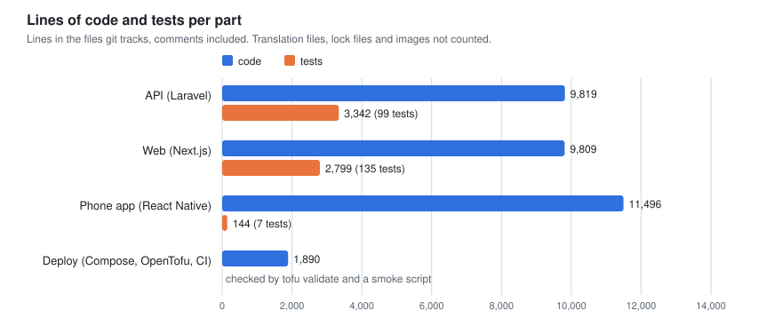

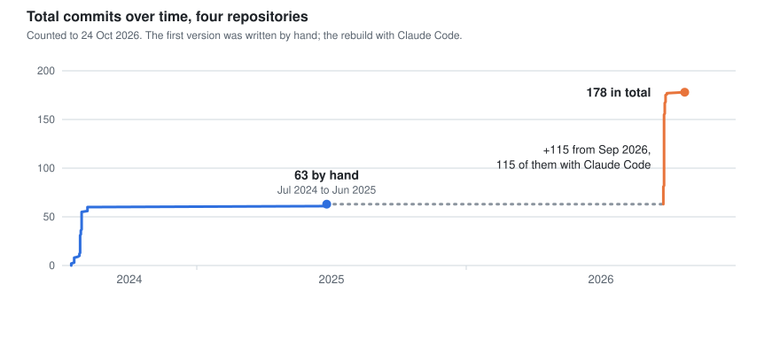

The phone app's own tests are few; its screens are the same as the web app's, which has most of the front-end tests.

## Stack

| Part | Folder | Technology |
|---|---|---|
| API | `api/` | PHP 8.3+, Laravel 13, tymon/jwt-auth, mPDF, PHPUnit |
| Staff app | `mobile/` | React Native 0.87, TypeScript, NativeWind, TanStack Query (persisted for offline), Jest |
| Web | `web/` | Next.js 16, React, MUI 9, TanStack Query, Vitest |
| Deploy | `infra/` | Docker Compose, Caddy, OpenTofu (AWS), GitHub Actions, Makefile |

Each folder has its own README: [`api/`](api/README.md) lists every endpoint, [`mobile/`](mobile/README.md) every screen, [`infra/`](infra/README.md) the deploy and runbook, and [`web/DESIGN.md`](web/DESIGN.md) the design system.

## Screens

Web app against the seeded demo data (production build). The phone app has the same screens. All names, phone numbers and plates are made up, and the inspection photos are generated placeholders.

| Today, in Arabic | Five languages |
|:---:|:---:|
| 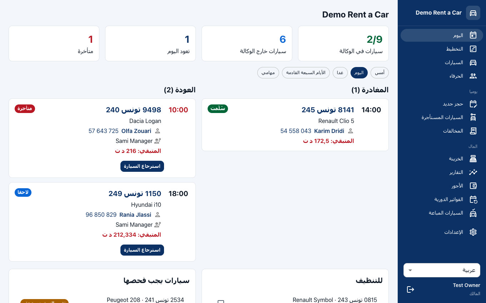 |  |
| **Planning** | **New reservation: free cars for a period** |
| 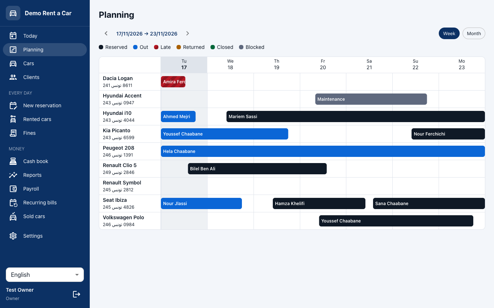 | 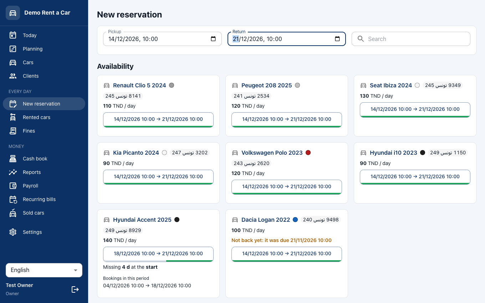 |
| **Taking a car back** | **A returned rental: photos side by side, damage, history** |
| 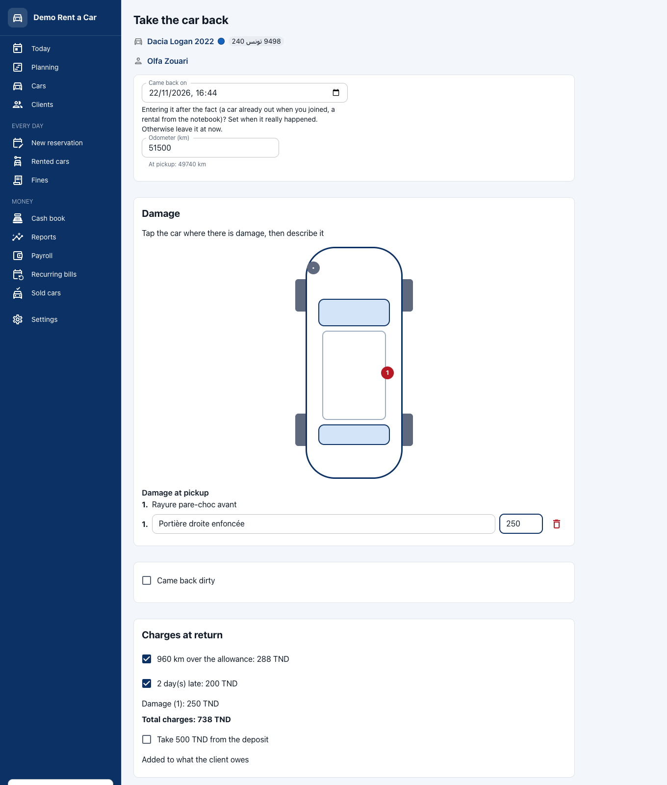 | 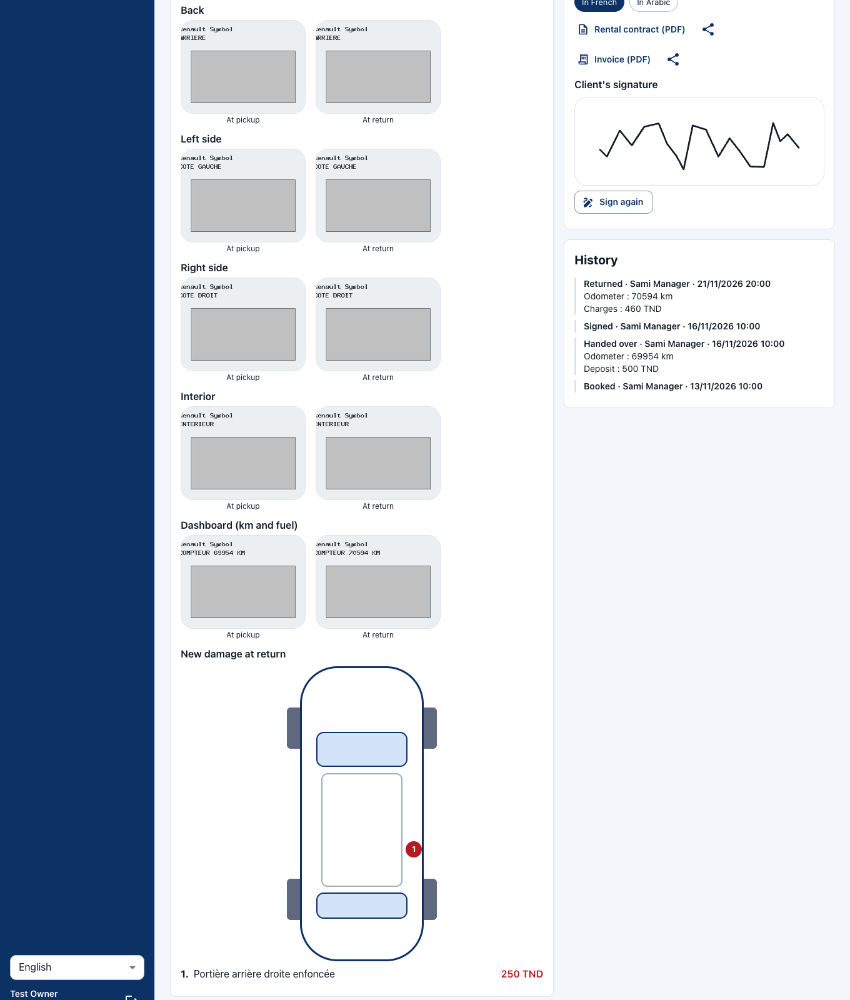 |
| **A flagged client and their numbers** | **What a car cost and earned back** |
| 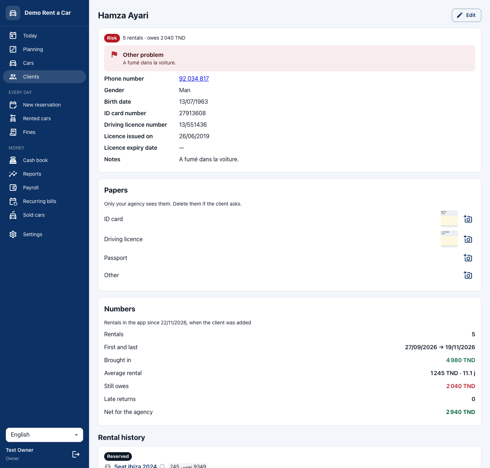 | 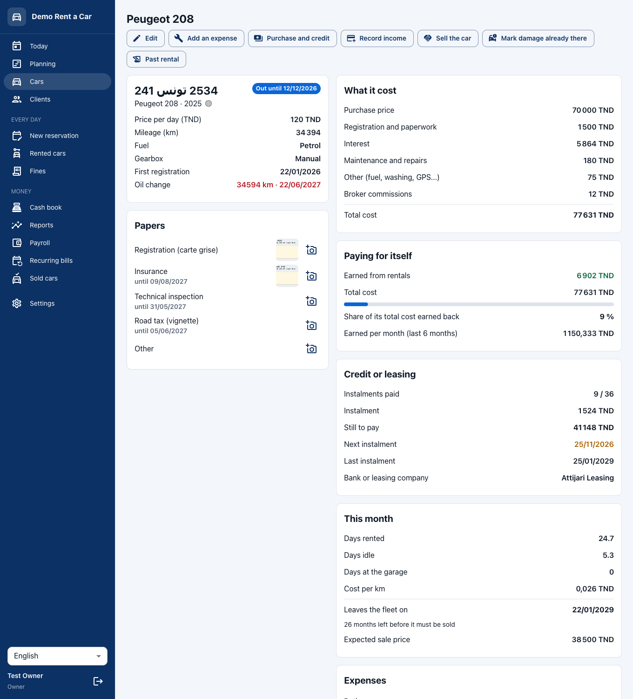 |
| **The client's check-in page** | **The contract as a PDF, in Arabic** |
| 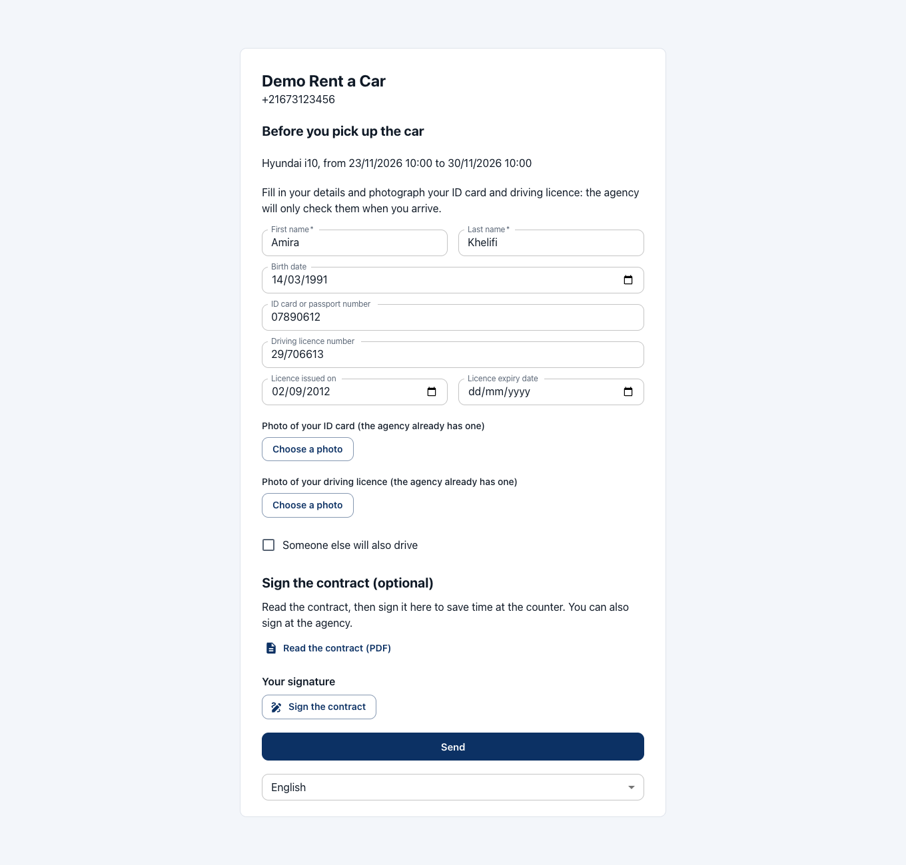 | 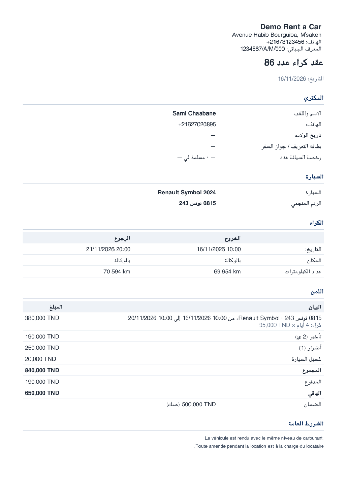 |
| **Cars** | **Reports** |
|  | 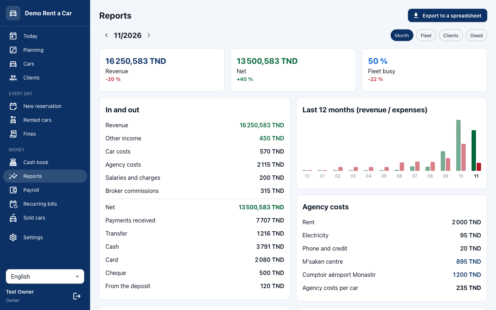 |

For the return screenshot the demo agency's kilometre charge was switched on (200 km a day included); the seed leaves it off.

## Videos

- [26 s demo](docs/media/brag.mp4): the paper notebook, the planning board, client check-in, import from Excel, themes. English, or [Arabic](docs/media/brag-ar.mp4).
- Product film, 2 min 27 s: a day in an agency on the web app, from the first call to the cash book and the monthly report. [English](docs/media/promo-en.mp4), [French](docs/media/promo-fr.mp4), [Arabic](docs/media/promo-ar.mp4).
- Cartoon film, 2 min 34 s: the same day told with cartoon staff and a client, with the app screens cut in. [English](docs/media/cartoon-en.mp4), [French](docs/media/cartoon-fr.mp4), [Arabic](docs/media/cartoon-ar.mp4).
- Short vertical film, 36 s: the phone app, from the paper notebook to reservations, signing and reports. [English](docs/media/short-en.mp4), [French](docs/media/short-fr.mp4), [Tunisian Arabic](docs/media/short-tnar.mp4).

The films use the same made-up demo data as the screenshots.

## Run locally

API (needs PHP and Composer):

```bash
cd api && composer install
cp .env.example .env && php artisan key:generate && php artisan jwt:secret
touch database/database.sqlite && php artisan migrate --seed
php artisan serve          # http://127.0.0.1:8000
```

Web (default API address is 127.0.0.1:8000):

```bash
cd web && npm install && npm run dev
```

The seeder builds a demo agency around today's date (nine cars, 31 clients, two months of rentals, fines, a dented door waiting to be settled) and a second agency, to check that neither sees the other's data. Its logins are fake and listed in [`api/README.md`](api/README.md). The phone app is described in [`mobile/README.md`](mobile/README.md); for a debug Android build, generate your own `android/app/debug.keystore`. The full Compose stack is in [`infra/README.md`](infra/README.md).

## Tests and CI

- API: `cd api && php artisan test` (99 tests on SQLite).
- Web: `cd web && npm test` (135 tests), plus `typecheck`, `verify:i18n` (every key in all five languages) and `build`.
- Mobile: `yarn lint`, `yarn test`, `tsc --noEmit`, and a release bundle for iOS and Android.
- GitHub Actions in `.github/workflows/`: one CI workflow per folder, started by a push or pull request that touches it (the API on PHP 8.4 and 8.5); image builds on a `v*` tag; a manual deploy through AWS Systems Manager.
- The Compose stack has run locally. The AWS and deploy code passes `tofu validate` but has never run against a real AWS account.

## How it was built

I designed and built this with Claude Code: I set the product and the architecture, and reviewed and tested the code it wrote. Each commit from September 2026 carries a co-author trailer, so `git log` in the private repositories shows it. This public copy was made from those four repositories as one commit.

## How these numbers were measured

On 22 November 2026, in this repository unless noted.

- Routes: `grep -cE "Route::(get|post|put|delete)" api/routes/api.php` (100).
- Tests: `public function test_` in `api/tests` (99); `it(` and `test(` calls in `web/test` (135) and `mobile/__tests__` (7).
- The API and web suites passed in this copy on 17 November 2026. The last CI run of each folder was green the same day.
- Strings: keys in each of the five `web/src/i18n/*.json` files (1,278; the Arabic-script files have 1,279).
- Lines: `wc -l` of the files `git ls-files` lists. API: PHP in `app`, `routes`, `database` and `resources`. Web: TypeScript in `src` and `pages`. Phone app: `src`.
- Deploy lines: the OpenTofu, YAML, Caddy and Make files and scripts in `infra` and `.github/workflows`. Test lines: `api/tests`, `web/test`, `mobile/__tests__`.
- Commits: `git log` in the four private repositories (API, app, web, infra), up to the last commit on 24 October 2026.
- A commit counts as written with Claude Code when it has a `Co-Authored-By: Claude` trailer: 115 of 115 since September 2026, none before.
- Themes: `Agency::THEMES` (18). Models: `api/app/Models` (20).

## Licence

All rights reserved. You may read the code to evaluate my work; copying, reuse or redistribution needs written permission. See LICENSE.
