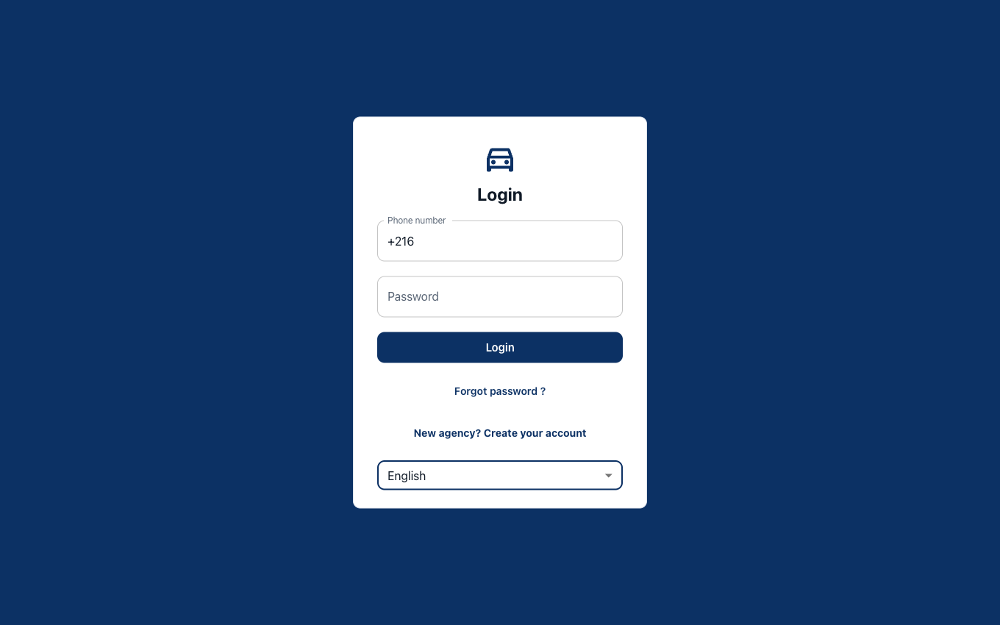
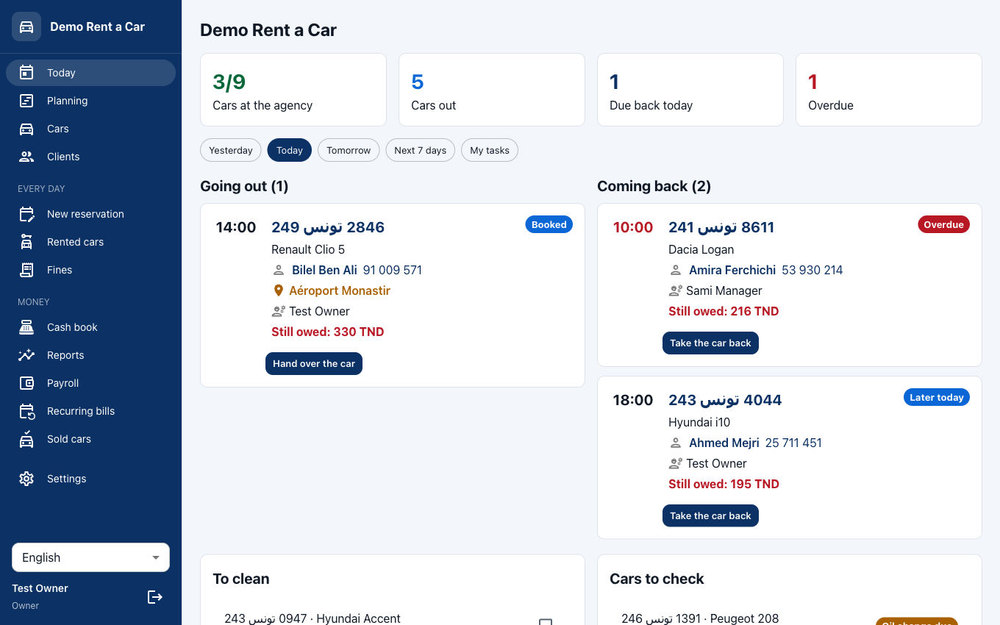
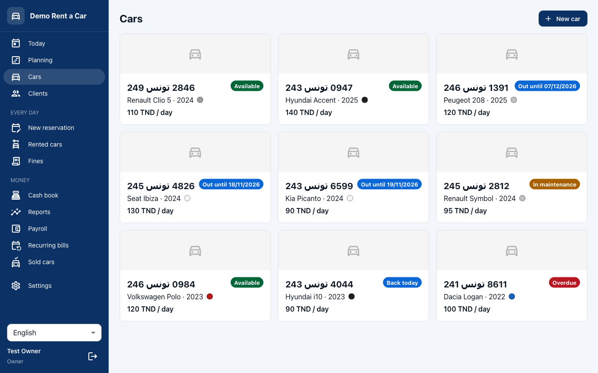
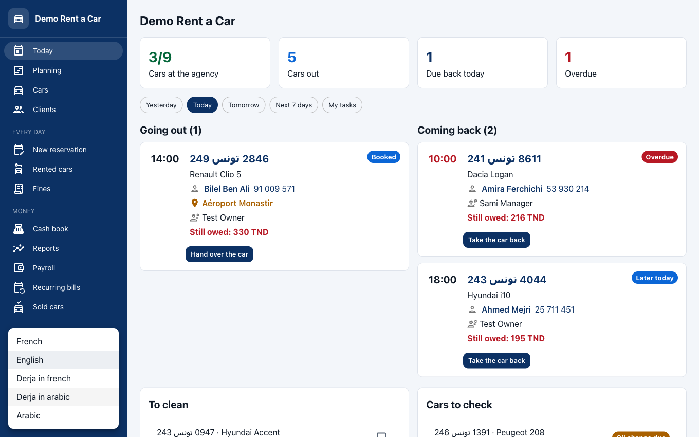

# Car Rental

A small-agency car rental system built end to end: a Laravel JSON API, a React Native staff app, a Next.js web version of the same app, and the Docker Compose, Caddy and OpenTofu files that deploy them. It replaces the paper bookkeeping of a rental agency in Tunisia: fleet, availability for a period, bookings, contracts, the cash book and reports. It shows one person delivering a full stack with tests, CI and deploy code, and careful handling of money (integer millimes, no floats).

## Features

- Fleet with purchase, credit, sale and profitability per car.
- Availability for a date range, with seasonal prices and long-rental discounts.
- Bookings and contracts: pickup and return with odometer, deposit, photos from fixed angles and damage marking.
- Offline handover on the phone, sent when the network returns.
- Clients with a track record and flags (unpaid, damage, late returns), also across changed phone numbers.
- Cash book, recurring bills, payroll, traffic fines, monthly reports with Excel export.
- Several agencies in one database, isolated from each other; owners and managers with different rights; branches.
- Five UI languages: English, French, Arabic, Tunisian Arabic in French letters (Derja bil français) and Tunisian Arabic in Arabic script.

## Architecture

```
 mobile (React Native)      web (Next.js + MUI)
          \                      /
           \--- HTTPS, JSON ----/
                     |
              api (Laravel 13, JWT)
                     |
          SQLite (tests) / MySQL (prod)

 infra: Docker Compose + Caddy (TLS, routing) on one server,
        OpenTofu for AWS (instance, database, registry, backups, alarms),
        GitHub Actions build images and roll the server.
```

## Stack

| Part | Folder | Technology |
|---|---|---|
| API | `api/` | PHP 8.3+, Laravel 13, tymon/jwt-auth, PHPUnit |
| Staff app | `mobile/` | React Native 0.87, TypeScript, NativeWind, TanStack Query (persisted for offline), Jest |
| Web | `web/` | Next.js 16, React, MUI 9, TanStack Query, Vitest |
| Deploy | `infra/` | Docker Compose, Caddy, OpenTofu (AWS), Makefile |

## Run locally

API (needs PHP and Composer):

```bash
cd api && composer install
cp .env.example .env && php artisan key:generate && php artisan jwt:secret
touch database/database.sqlite && php artisan migrate --seed
php artisan serve          # http://127.0.0.1:8000
```

Web (default API address is 127.0.0.1:8000):

```bash
cd web && npm install && npm run dev
```

Demo logins are fake seed data and are listed in `api/README.md`. The phone app is described in `mobile/README.md`; for a debug Android build, generate your own `android/app/debug.keystore`. The full Compose stack is in `infra/README.md`.

## Tests and CI

- API: `cd api && php artisan test` (99 tests, SQLite).
- Web: `cd web && npm test` (135 tests in 19 files), plus `typecheck`, `verify:i18n` and `build`.
- Mobile: `yarn lint`, `yarn test`, `tsc --noEmit`, and an iOS and Android bundle check.
- GitHub Actions in `.github/workflows/`: CI per folder with path filters; image builds on a `v*` tag; a manual deploy through AWS Systems Manager. The infra and deploy code has never run against a real AWS account.

## Screenshots

Web app in English against the seeded demo data (production build).

| | |
|---|---|
|  |  |
|  |  |
|  |  |

## How it was built

Motaz designed and built this with AI-assisted development (Claude Code): he set the product and architecture, and reviewed and tested the code the assistant wrote.

## Licence

All rights reserved. You may read the code to evaluate my work; copying, reuse or redistribution needs written permission. See LICENSE.
